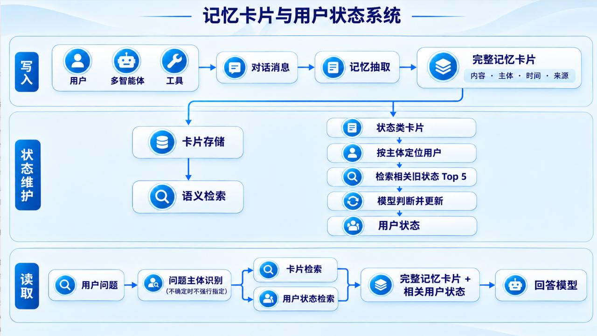

# 多用户共享记忆：Card–State–Sleep

本项目面向多用户、多智能体共享对话记忆的场景。系统从用户、智能体或工具产生的消息中提取记忆卡片，维护与用户有关的状态，并在回答问题时结合卡片和状态提供上下文。

研究重点是：**记忆记录了什么、事实涉及谁、用户的情况如何变化，以及回答时应该使用哪些证据**。说话人、动作执行者、事实主体和提问者可能不是同一个人，因此不能仅凭消息是谁说的，就把事实归到这个人名下。

## 方法流程图

流程分为三部分：**写入**负责从对话中形成记忆卡片；**状态维护**负责根据与用户有关的卡片整理用户状态；**读取**负责根据问题获取相关记忆并生成回答。图展示的是方法流程，其中状态 Top 5 检索和问题主体识别属于后续实验方案，与本仓库默认实现存在差异，详见[流程图与当前代码的对应关系](#流程图与当前代码的对应关系)。

## 核心组成

| 组成 | 作用 | 主要内容 |
| --- | --- | --- |
| 记忆卡片（Card） | 保留一条可检索的记忆及其来源 | 记忆内容、主体、说话人、来源、状态主题、使用提示和可用的时间信息 |
| 用户状态（State） | 整理与某个用户有关的持续信息 | 偏好、约束、计划、个人信息和目标，以及每个状态条目的确定程度、支持卡片 |
| 状态维护（Sleep） | 利用新卡片维护已有状态 | 判断新增、更新、移除或保持不变，并保存支持依据 |
| 检索与回答 | 根据问题使用已有记忆 | 检索卡片、获取相关状态，将上下文交给回答模型 |

**卡片和状态的职责不同。**卡片用于保留具体记忆及其来源；状态用于组织对理解某个用户有用的信息。不是每张卡片都必须变成状态条目，状态也不能替代原始证据。

## 一、写入：从消息到记忆卡片

### 1. 接收消息和必要的上下文

系统通过 `/messages` 接收消息。消息包含文本、消息 ID、提交者身份等信息，也可以附带来源时间、元数据和有限的前文。前文用于帮助理解指代，但消息中的内容依然是待处理的数据，不应被当作系统指令。

不同来源可能包含不同性质的信息：用户陈述、其他人的转述、智能体推测、工具返回或未来计划等。抽取时需要保留原本的表达方式，不能把“计划完成”写成“已经完成”，也不能把别人的转述当成当事人亲自确认。

### 2. 抽取事实并识别主体

在默认共享池模式下，模型根据当前消息和提供的前文生成零张或多张卡片。抽取时关注：

1. **说话人**：消息由谁发出；
2. **记忆内容**：消息中需要保留的事实、计划或其他信息；
3. **主体**：这条记忆主要描述的具体用户；
4. **来源**：当前消息中的相关原话，以及理解归属时需要的前文；
5. **状态主题**：这条卡片是否与用户的偏好、约束、计划、个人信息或目标有关；
6. **使用提示**：对可能使用场景的简短提示，不作为新增事实或状态结论。

例如，小王说“我把小李的会议改到了周五”，小王是说话人和动作执行者，会议安排涉及小李。主体应根据被记录的具体事实判断，不能只根据说话人确定。

如果主体不明确，或者消息主要描述公共事项，卡片可以保留为空主体；它仍可进入共享记忆池，但不会因为猜测而进入某个人的状态。模型应保留原文中的日期、条件和相对时间；来源时间未知时，不把系统处理时间当作消息发生时间。

### 3. 保存和索引卡片

系统为卡片分配标识，保存内容和来源，并使用 MemOS / Qdrant 为共享池建立检索索引。卡片保留的时间与来源信息取决于输入和抽取结果；“完整记忆卡片”表示卡片作为回答证据使用，并不保证抽取一定完整或语义一定正确。

对于主体和状态主题均明确的卡片，系统会将其登记为待维护项，供后续 Sleep 处理。卡片保存与状态更新是两个步骤：卡片写入后，相关状态可能暂时还没有更新。

## 二、状态维护：根据新卡片整理用户状态

状态用于组织用户长期或当前有用的信息，例如偏好、限制、计划、个人信息和目标。一个用户可以有多条状态，一张卡片也可以涉及多个状态主题。

### 1. 找到待处理卡片

写入时，具有已知主体和状态主题的卡片进入待处理队列。Sleep 维护时，将可处理的待处理卡片按主体归组，并取出该用户已有状态作为更新依据。主体不明确或没有状态主题的卡片不会被强行写入个人状态。

### 2. 判断新卡片与已有状态的关系

模型比较已有状态和新卡片，决定是否对状态条目进行操作：

- **新增**：出现值得保留的新事项；
- **更新**：新信息补充或改变了已有事项；
- **移除**：提供的证据支持从当前状态中移除某条内容；
- **不变**：新卡片重复已有信息，或没有充分依据修改状态。

模型需要保留时间、条件、来源和不确定性，避免把不同事项强行合并。后出现的一句话也不必然替代前一句：它可能是在描述另一件事、未来计划或尚未生效的条件。

### 3. 校验并保存状态

模型返回的操作包含状态主题或已有条目 ID、内容、确定程度以及相关证据卡片 ID。程序检查操作结构、条目 ID 和证据 ID 是否属于允许范围，再保存更新；处理失败时保留原状态和待处理项，便于排查或重试。结构校验不能证明模型对事实关系的语义判断一定正确。

Sleep 是维护阶段，不等同于“消息写入后立即完成所有状态更新”。本仓库提供 `/sleep` 入口及调度器；实际何时触发取决于调用方式和调度安排。

## 三、读取：从问题到回答

### 1. 理解问题和可能涉及的用户

读取时需要考虑问题在问谁、问什么，以及它要求当前情况还是历史情况。提问者不一定是问题的主体；问题也可能询问公共事项，或者没有明确指定某个人。

流程图中的“问题主体识别”表达的是：只有当问题或可信上下文提供了足够依据时才指定人物，否则保留不确定。它不应根据问题中的称呼、最近出现的名字或答案猜测人物。

### 2. 检索记忆卡片和相关状态

卡片检索使用问题对共享记忆进行语义搜索，返回相关候选。主体、说话人和参与者各自有不同含义：只按某一个主体字段严格过滤，可能错过由其他人说出、但与问题直接相关的证据。

状态用于补充理解用户的偏好、计划和当前情况。读取时应同时考虑相关状态、支持状态的卡片、尚未完成维护的卡片，以及可能存在的新旧冲突；旧状态不能自动否定尚未处理的新证据。

本仓库默认读取路径如何获取状态，见下方实现说明；图中独立状态检索是研究流程的一种设计，不应理解为所有状态都已被准确召回。

### 3. 生成回答

系统把检索到的卡片及可用的相关状态组织为证据上下文，回答模型根据问题生成结果。卡片的使用提示只是辅助信息，不能替代事实、来源和时间条件；当证据不足或存在冲突时，应保留不确定性。

在现有接口中，`/read` 生成证据包并返回其 ID，`/answer` 使用该证据包生成回答。代码会检查回答引用的卡片 ID 是否属于当前证据包，但这不等于已经证明回答的每个结论都正确。

## 示例：用户计划发生变化

假设小李先说“我计划周三开会”，随后说“会议改到周五”。系统的目标处理过程是：

1. **写入**：分别生成两张卡片，保留计划内容、涉及人物及各自来源。
2. **状态维护**：比较新卡片和已有计划，判断它们是否指向同一场会议；证据充分时更新相关状态，证据不足时保留不确定。
3. **读取**：有人问“小李的会议计划是什么”时，检索相关卡片与可用状态，结合来源和时间回答。

这个例子用于说明方法意图。当前模型仍可能把新旧信息错误合并、同时保留相互冲突的状态，或未能检索到关键证据，不能保证每次都完成正确更新。

## 流程图与当前代码的对应关系

流程图用于展示整体方法，其中一些模块来自后续研究方案。为了便于理解代码，下面区分设计与当前仓库的默认实现：

| 流程环节 | 当前默认实现 | 图中或后续实验方案 |
| --- | --- | --- |
| 卡片抽取 | 从消息生成卡片，主体不明确时可保留为空 | 持续改进人物归属与来源理解 |
| 状态维护 | Sleep 将待处理卡片按主体归组，结合该用户已有状态生成操作 | 图中“逐卡检索相关旧状态 Top 5”属于独立实验方案，**未集成为本仓库默认维护流程** |
| 卡片检索 | 在共享池的公共索引中语义检索，默认候选上限由配置控制 | 图中卡片检索表示这一通路 |
| 问题主体与状态读取 | `/read` 接收 `subject_ids`；共享池模式下，卡片检索不按该字段过滤，用户状态主要通过已检索卡片的证据关联获取 | 图中的问题主体识别和独立语义检索状态属于后续探索，**不是当前默认端到端读取路径** |
| 回答 | 使用证据包中的卡片、可用状态和待维护主体信息生成回答 | 仍需检验证据充分性、状态质量和回答可靠性 |

默认配置是**共享记忆池**。仓库保留了一些历史治理模式相关代码，但默认共享池不应被视为已经完成细粒度权限控制、撤权或结构化删除治理。项目目前是研究原型，尚未实现完整的多智能体任务编排系统。

## 代码位置

- [`src/ours_memory/multiuser.py`](src/ours_memory/multiuser.py)：消息写入、状态维护、共享池读取及回答。
- [`src/ours_memory/prompts.py`](src/ours_memory/prompts.py)：卡片抽取、状态维护和问题主体等提示词。
- [`src/ours_memory/memos_backend.py`](src/ours_memory/memos_backend.py)：MemOS 存储与检索适配。
- [`src/ours_memory/scheduler.py`](src/ours_memory/scheduler.py)：Sleep 调度。
- [`src/ours_memory/api_v2.py`](src/ours_memory/api_v2.py)：消息、读取、Sleep 和回答等 API。
- [`src/ours_memory/baselines/`](src/ours_memory/baselines/)：Naive RAG、Mem0、A-MEM 和 MemOS 基线适配；上游来源见 [`baseline-sources.json`](baseline-sources.json)。
- [`configs/multiuser.json`](configs/multiuser.json)：默认共享池配置；环境变量示例见 [`.env.example`](.env.example)。
