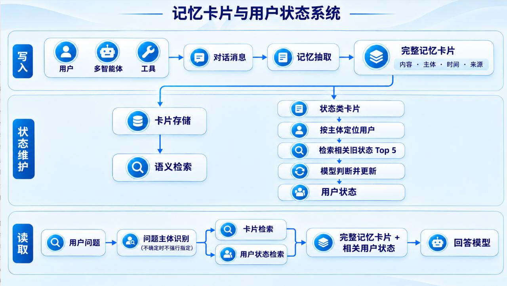

# 多智能体共享记忆课题现状与进展

## 一、课题面向什么问题

本课题面向**多用户、多智能体共享对话与记忆**的场景，研究如何从多人、多轮消息中保存事实，判断事实与哪些人有关，在新信息到来时维护用户状态，并在回答问题时正确使用相关证据。

例如，小王说：“我把小李的会议改到了周五。”这句话的说话人和动作执行者是小王，会议安排涉及小李。之后如果询问“小李的会议什么时候开”，系统需要找到这条消息，并区分说话人、执行者和事实涉及的人。

当同一事项随着时间变化时，系统还需要区分旧信息、当前信息、计划和已发生事实，避免把两条相关但不同的消息简单合并或覆盖。

课题目前主要聚焦三个问题：

1. **记忆归属**：一条事实涉及哪些人，谁是说话人、执行者和事实主体？
2. **记忆更新**：新信息到来后，如何维护已有状态、识别冲突并保留证据？
3. **记忆使用**：面对问题，如何检索相关卡片和状态，并完成跨事实、跨事件推理？

当前重点是共享记忆及其问答能力。仓库中保留了早期治理相关代码，但默认共享池不应被视为已经完成细粒度权限控制、撤权和结构化删除。完整的多智能体任务编排系统也尚未完成。

## 二、采用的方法：Card–State–Sleep

系统将处理过程分为写入、状态维护和读取三个阶段：

| 模块 | 作用 | 主要内容 |
| --- | --- | --- |
| Card：记忆卡片 | 从消息中保存可检索、可追溯的信息 | 内容、主体、说话人、来源、状态主题、使用提示及可用时间信息 |
| State：用户状态 | 组织某个用户值得持续关注的信息 | 偏好、约束、计划、个人信息、目标及其支持证据 |
| Sleep：状态维护 | 利用新卡片维护已有状态 | 对状态进行新增、更新、移除或保持不变 |
| 检索与回答 | 根据问题组合可用记忆 | 检索卡片，获取相关状态，交给模型回答 |

**写入阶段**：从消息及有限前文抽取卡片；主体不明确或主要描述公共事项时，可以保留空主体卡片，而不是强行归属于某个人。

**状态维护阶段**：具有已知主体和状态主题的卡片进入待处理队列，Sleep 结合新卡片和已有状态生成维护操作；程序检查操作格式、状态条目和证据卡片 ID。结构校验不能保证模型的语义判断正确。

**读取阶段**：根据问题从共享池中语义检索卡片，并获取可用的相关用户状态，形成证据上下文后交给回答模型。状态可能尚未处理最新卡片，因此旧状态不能自动否定新证据。

## 三、目前的主要实验结果

### 3.1 GateMem：20 个场景的共享记忆实验

在冻结的前 20 个场景中，共评测 483 个检查点，其中 158 个为效用题。新版共享池的效用与已有基线如下：

| 系统 | 效用 U |
| --- | ---: |
| Naive RAG | 53.80% |
| Mem0 | 62.03% |
| A-MEM | 55.06% |
| MemOS | 41.14% |
| 我们的新版共享池 | **62.03%** |

这批结果说明系统具备一定的记忆问答能力，效用与该批历史 Mem0 结果相同。但基线和新版并非完全同时间、同配置运行，回答长度上限等存在差异，因此不能据此给出严格排名或宣称显著优于基线。

实验还按原基准口径记录了隐私和删除相关题目的回答表现。由于本次采用共享池模式，未实现完整权限控制和结构化删除，相关自动判分不能证明系统具备这些治理能力。

### 3.2 GateMem：逐卡状态更新和卡片链接

在另一轮前 20 个场景的同轮回放中，比较原流程、逐卡状态版和加入卡片链接的版本：

| 同轮方案 | 效用通过数 | 效用 U |
| --- | ---: | ---: |
| 原流程 | 97/158 | 61.39% |
| 逐卡状态版 | 107/158 | **67.72%** |
| 逐卡状态 + 卡片链接版 | 104/158 | 65.82% |

逐卡状态版在这次回放中有提升信号；加入链接后未超过逐卡状态版。实验采用单次生成和自动裁判，裁判存在误判和波动，不能据此断言稳定因果收益或统计显著性。

### 3.3 EverMemBench：多人长对话实验

在 EverMemBench 项目 01 上，逐卡影子状态实验处理了 **10,222 条消息、38 名发言人和 488 道题**，完成 488 题回答和评分，结果为 **284/488，约 58.20%**。这是项目 01 的结果，不代表整个数据集。

| 题型 | 我们的结果 | 初步反映的问题 |
| --- | ---: | --- |
| 单跳事实题 F_SH | 39/43 | 部分直接事实能够较好回答 |
| 多事件、多跳题 F_MH | 0/50 | 跨事件检索和关联明显薄弱 |
| 时间推理题 F_TP | 1/60 | 事件定位、时间判断与推理存在明显困难 |
| 人物风格题 P_Style | 14/37 | 人物特征的提取、检索和使用不稳定 |

同一项目已有的完整结果包括 Mem0 **299/488**、Naive RAG **281/488**、MemOS **267/488**；运行时间、配置等存在差异，不宜仅凭数字认定严格排名。A-MEM 在该项目的运行和评分受大量余额不足错误影响，不能作为有效完整基线。

该次实验状态记录中有 **294 个 Sleep issues**；488 题已完成评分不代表状态维护过程没有异常。这里的 issue 数量不能直接解释为独立错误消息数或状态错误率。

## 四、结果不理想后，已经尝试的改进

| 改进 | 想解决的问题 | 已观察到的效果 | 目前判断 |
| --- | --- | --- | --- |
| 逐卡更新状态 | 同时处理较多卡片和旧状态时，模型难以找到需要更新的条目 | GateMem 一轮同场景回放中，效用 61.39% → 67.72% | 有正面信号，但旧状态仍可能没有被替换，需独立重复验证 |
| 建立新旧卡片链接 | 帮助识别完整替代、部分更新等关系 | 同轮效用 67.72% → 65.82%；复杂关系会触发回退 | 当前实现未显示稳定收益，复杂关系判断仍是难点 |
| 调整状态检索与排序 | 正确状态存在但未进入回答上下文 | 首批 15 道人物题部分排序从 3/15 到 5/15 或 6/15；另一批 15 题未复现 | 还不能确定 State 的独立贡献或最佳选择策略 |
| 添加消息先后顺序 | 帮助区分旧消息和新消息 | GateMem 探索题自动裁判 40/60 → 47/60，但至少一题有裁判误判；EverMemBench 新样本 19/30 → 20/30 | 有局部信号，跨数据集稳定性未证实；消息顺序不等于事件生效时间 |
| 多事件拆分、事件配对和程序算时间 | 找到同一人前后两个事件并计算间隔 | 13 题拆分检索前后均为 1/13；一组 6 题事件配对得到 1/6 | 瓶颈不仅是计算，还包括判断是否同一事件、是否为下一项任务 |
| 补充原始消息或证据导航 | 弥补抽取遗漏和检索不到证据 | 30 题中，对照、补原始消息和导航均为 20/30 | 未观察到总体提升；额外上下文和调用也可能带来成本与干扰 |
| 主体归属复核与反思 | 纠正说话人、被提及者和事实主体混淆 | 部分小样本中修正了错误；发现只按主体字段过滤会漏掉真正证据 | 方向值得研究，但缺少充足的独立标注真实纠错案例 |

### 4.1 State 消融的补充说明

在固定 50 道 EverMemBench 题的对照中，保持卡片等条件一致，带状态和不带状态均为 **20/50**。这说明该次对照没有观察到总通过数改善，但不等于已经证明 State 无用：状态质量、相关状态是否进入上下文、题型分布以及模型波动都可能影响结果。

状态规模也带来检索和成本压力：一份快照中有 **10,509 条状态、38 名用户**，每人状态条数中位数 224.5，最多 782。状态数量多不等于重复或错误，但需要进一步验证如何高效找到与问题相关的状态。

### 4.2 主体归属的具体发现

在一道人物问题中，题目询问 A 提出的建议；包含答案的卡片主体字段是 B，因为卡片记录的事项与 B 有关，而 A 是说话人和建议提出者。如果只检索 `subject = A` 的卡片，就会把关键证据过滤掉。

这说明检索需要区分**事实主体、说话人、动作执行者和其他参与者**。多种人物线索可以帮助召回候选，但“某人在卡片中被提到”不等于“事实属于这个人”。

11 月 6 日的 Qwen 小样本试验中，独立复核纠正了部分说话人与被提及者混淆的问题。但样本由研究者选取、规模小、相互关联，且缺乏足够的自然后续纠错正例，不能据此宣称反思机制在真实对话中有稳定增益。

## 五、目前最大的困难

**核心困难是：缺少一种足够可靠的方法，把人物、事实、事件、时间和证据关联起来，并在新消息出现后正确修正这些关联。**

### 5.1 人物归属容易混淆

一条消息可能出现多人，说话人、动作执行者、被讨论者和接收者不一定相同；代词、别名、多人共同参与和部分身份未知会进一步增加难度。判断错后，错误可能进入卡片、状态和最终回答。

现有程序对模型输出进行字段和部分依据检查，但原文中确实出现某个名字或引文，并不能单独证明它在语义上支持模型给出的归属。

### 5.2 难以可靠判断新旧信息的关系

同一个人的两条相关信息可能表示同一事项更新，也可能是不同事项；可能是一项计划、愿望、转述，或已经发生的事实。现有系统可能新增新状态但保留过时状态，也可能错误合并语义相近但含义不同的内容。

### 5.3 复杂问题需要多条证据协同

多跳与时间题不仅需要检索相关消息，还需要识别事件边界、确认人物和项目关联、选择起点与终点，再判断时间含义。即便找到部分相关卡片，仍可能把对旧任务的澄清误认为下一项新任务。
